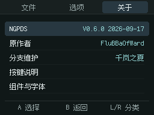
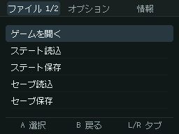
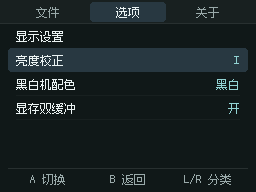
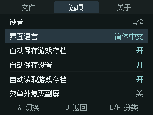

# Minimal menu hierarchy and footer alignment

This candidate implements the approved layout on top of the startup-audio build. It keeps the selected font, palette, 24px row height, original row selection and separators, and a fixed footer at y=168.

- Top-level File/Options/About pages omit their repeated heading. Rows begin at y=36. Multi-page File adds its page counter to the active tab; one-page menus omit `1/1`.
- Submenu titles and browser paths remain, starting at x=16 with a counter right-aligned at x=240 when needed. Their rows remain at y=48.
- Only a full five-row top-level list gets two 1px edge rules, using the existing separator color. They are drawn behind the unchanged rows. One-to-four-row lists receive no extra rules or panel/background fill. The shared hierarchy/footer updates still intentionally affect those screens; whole-screen identity to the old release is not claimed.
- Footer groups are centered at x=48/128/208 using actual translated text widths. A/B touch regions follow the first two 80px columns. L/R remains a physical-shoulder-button hint.
- Menu touch selection uses the current row origin. It excludes the gap below a root list so touching it cannot select an off-page item. Browser row origin, long-name scrolling and modal navigation remain consistent.
- Page capacity remains five. No balanced `4+4` pagination, filled panel, new font or new color is included.

## Verification

`python3 tests/run_ui_tests.py --sanitize` checks root/submenu origins, hidden single-page counters, title margins, 30 one-to-four-item cases with no additional hairline pixels, 15 five-item cases restricted to the two edge rows, and footer centering/clearance in English, Simplified Chinese and Japanese.

Headless NDS tests cover the three locales, first/last selection, file page switching, three-row submenus, no action in the lower blank gap, and touch at the right edges of the A/B columns. Actual root captures retain visible y=36..155 bounds whether the first or last item is selected. Menu/settings power and persistence, UTF-8 file selection, old state import and menu-input isolation pass their repeated cases.

Four short Pure/Cure JP/ZH runs preserve the selected RGB5 game frames and have active audio. A fresh cold-launch recording retains the soft-start peak of 513 and maximum sample step of 2. StartupAudio.c, Sound.s, PSG/DAC, CPU, graphics and persistence sources are unchanged from the preceding audio candidate; the earlier 35-callback synthesis identity evidence is reused, not presented as newly rerun.

A clean build matches the tested binary. Six inherited warnings remain; the layout adds no warning. This is emulator acceptance, not new physical R4/NDSi acceptance. Full README restructuring and Fusion Edition naming remain separate from this test candidate.

[Exact binary and results](menu-layout-validation.json)

| Chinese About | Japanese File |
| --- | --- |
|  |  |

| Three-row submenu | Settings |
| --- | --- |
|  |  |
