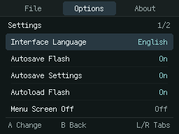
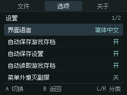
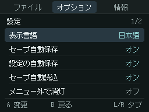
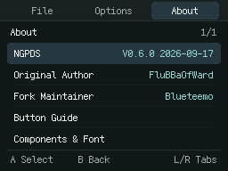
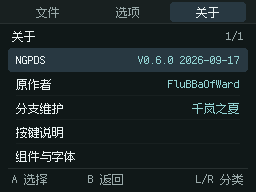
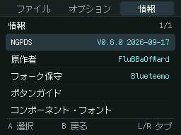

# Trilingual menu candidate

This personal-fork branch adds English, Simplified Chinese and Japanese interface languages on top of the accepted combined Pure/Cure build and selected graphite border. It is a **test candidate**, not a new upstream release or a new hardware acceptance result.

## Use

Open the menu with L+R, then choose **Options → Settings → Interface Language**. A cycles English → 简体中文 → 日本語. L/R changes top-level tabs; Left/Right moves five entries; Up/Down selects an item. Touch selects a row, and touching it again activates it. The footer A/B areas also accept touch.

**Menu Screen Off** turns off the unused screen/backlight while the menu is closed and restores it when the menu opens. If the emulator is on the bottom screen, the top screen turns off instead. This reuses the existing power-save option; it does not change the game's brightness or audio. No physical battery-life measurement was made.

With **Autosave Settings** enabled, leaving the menu persists the interface language and other preferences. With it disabled, use **File → Save Settings**. Existing disabled preferences remain disabled. **Autosave Flash** concerns in-game Flash progress; save states remain a separate manual feature. **Console Language** still controls the NGPC's Japanese/English setting independently of the interface.

## Implementation and compatibility

- Native Fusion Pixel 12px for all three languages, with Japanese glyph overrides; Latin advance 6px and CJK advance 12px. No runtime resizing or antialiasing. Retained upstream font sources and licenses are in `third_party/fusion-pixel-12px/`.
- A five-row, 256×192 menu uses a 24 KiB 4bpp canvas and 768 dirty flags. It reuses VRAM H, uploads changed tiles through CPU stores, and adds no DMA or HBlank handler. A single full presentation copies at most 24 KiB; multiple menu redraws can occur during an input event. This is not a measured per-frame hardware budget.
- `Menu.c` adapts the existing Shared menu interfaces locally. `Shared/EmuMenu.c` is excluded from this build; no dependency revision or dependency source is changed. Its MIT notice is retained in `Docs/licenses/NDS_Shared-menu.txt`.
- The existing 792-byte settings layout is unchanged. A tagged value in the previously unused word records the UI language; unknown legacy contents are preserved until a translated UI is selected. `.fla` and `.sta` formats are unchanged. UTF-8 filenames are displayed without translation; unsupported glyphs fall back to `?`.
- Empty HLE operation now stays idle when no cartridge or BIOS for the active machine is loaded, including when Autopause Game is disabled. Debug Step Frame displays a message instead of entering an uninitialized CPU. Inserted cartridges and matching real-BIOS operation retain the existing path. A Color BIOS does not make an empty monochrome HLE console runnable.
- Rendering, CPU, audio, FlashStore and SafeFile implementations remain byte-for-byte unchanged from the graphite baseline. This does not add an audio-accuracy improvement.

## Build and host tests

Keep the pinned submodules and nested dependencies. With an existing Wonderful/BlocksDS installation:

```sh
git clone --recursive --branch personal/trilingual-menu https://github.com/Blueteemo/NGPDS.git
cd NGPDS
export WONDERFUL_TOOLCHAIN=/path/to/wonderful
export BLOCKSDS="$WONDERFUL_TOOLCHAIN/thirdparty/blocksds/core"
export BLOCKSDSEXT="$WONDERFUL_TOOLCHAIN/thirdparty/blocksds/external"
make -j8 COMPDB=0
python3 tests/run_ui_tests.py --sanitize
python3 tests/test_config.py
```

Committed font binaries make normal builds independent of Python or network access. `python3 tools/build_ui_font.py` regenerates them from the retained compressed BDF sources. Host UI tests need only a C compiler and Python 3; no ROM, BIOS or NDS SDK. Persistence tests are unchanged and remain in `tests/`.

## Validation scope

The local candidate passed strict UTF-8/configuration/canvas host tests, ASan/UBSan save tests, actual FAT-image language save/cold restore, touchscreen and key navigation, modal browser tabs, UTF-8 filenames, both display orientations and the existing power-save flag. An old graphite-build state for a 2 MiB Cure translation was loaded and resaved; the resaved state has the same length, **not identical bytes**. A valid eight-byte empty Flash file was accepted.

Seven short paired cases (three original scroll diagnostics and Pure/Cure JP/ZH) were run against the graphite baseline in all three UI languages. The selected final frames had zero differing RGB5 game and border pixels in 21 comparisons. These are bounded emulator checks, not a full-game replay or renewed long audio/performance acceptance.

The enlarged executable/font data still allowed the existing 2 MiB + 4 KiB ROM allocation in ordinary DS-mode simulation. Physical R4 timing, SD behavior, battery savings and multilingual readability on the actual LCD remain unverified for this candidate. Earlier hardware feedback concerns the pre-menu optimized graphics build only.

## Actual emulator captures

| English | 简体中文 | 日本語 |
| --- | --- | --- |
|  |  |  |

[Machine-readable validation summary](menu-validation.json) records the tested binary hash, memory sections and comparison results.

## Startup B correction and About layout

Before this correction, a fresh session with Auto machine selection and only a Color BIOS configured could hang after B closed the startup menu. Auto selected the monochrome machine without a cartridge, while the menu incorrectly treated *either* loaded BIOS as permission to run that machine. It then entered the empty monochrome HLE CPU. L+R could no longer reopen the menu. The previous no-BIOS checks did not cover this partial-BIOS configuration.

The shared predicate now permits execution with an inserted cartridge or a real BIOS matching the **active** machine. Menu close, idle scheduling and Debug Step Frame use the same predicate. It preserves standalone Color BIOS execution when Color is the active machine. No ROM, audio clock, graphics pipeline or save-format changes are involved.

The regression covers 12 emulator combinations of no BIOS / Color BIOS, Auto / monochrome / Color selection, and Autopause on / off, including the same relevant flags as the user card. A separate host test compiles the actual predicate and checks all 16 cartridge/machine/BIOS combinations, without distributing a BIOS:

```sh
python3 tests/test_console_program.py
```

The About home page now has five entries: upstream version, original author, fork maintainer, button guide, and components/font details. The maintainer is **千岚之夏** in Chinese and **Blueteemo** in English/Japanese, without parentheses. Button mappings and core/font versions remain available in their detail pages; the current game is omitted from About.

| English | 简体中文 | 日本語 |
| --- | --- | --- |
|  |  |  |

This correction has automated emulator acceptance, not a new physical NDS/R4 pass. The old candidate and its evidence remain preserved locally.

## Quiet startup and menu-dismissal input

Successful startup settings loading and automatic Flash loading are silent. File → Load Flash still confirms a successful explicit request. Invalid/unreadable Flash, settings errors and save failures retain their messages and protection. Automatic state-loading feedback is unchanged.

Closing a menu now consumes the action keys held at dismissal until each is released. This includes the same frame that resumes the emulated CPU; a second press after release is delivered normally. Directional input is retained. A touch-only dismissal does not consume a newly pressed game key. This adds a four-byte release mask and constant-time filtering, with no audio/core/register timing or persistence-format changes.

New checks compile the actual menu-exit barrier and release filter, exercise independent releases and retained direction input, and assert that successful config loading is silent while read errors remain reported:

```sh
python3 tests/test_menu_release.py
python3 tests/test_config.py
```

Emulator checks observe both EMUinput and the hardware joypad byte at `systemMemory + 0xB0` in NGPDS. In all four Autopause on/off × A/B mapping combinations, the dismissal press and continued hold produce no game action; a fresh press after release produces the expected mapped button. Isolated FAT tests cover silent automatic Flash loading, confirmed manual loading, and visible corrupt-save rejection. Prior startup-B, language/power/state tests and 21 selected RGB5 game comparisons were repeated. This remains automated acceptance, without new physical console validation.

## Subsequent startup-audio candidate

A launch-only soft start is documented separately in [STARTUP_AUDIO.md](STARTUP_AUDIO.md), with its exact binary and fresh audio regressions. The earlier menu-validation JSON retains the hash and scope of the preceding UI build. The proposed menu hierarchy mockups are not implemented in this audio candidate.

## Approved menu hierarchy and footer

The formerly separate preview is now implemented: [layout, touch behavior and validation](MENU_LAYOUT.md). It uses thin list edges rather than a filled panel, hides repeated top-level titles and single-page counters, and centers footer hints in three columns. The older menu-validation JSON remains evidence for its own binary.
